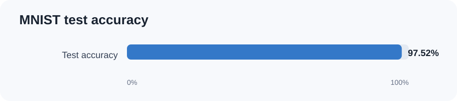

# MNIST Handwritten Digit Recognition

**Recognize handwritten digits (0–9) using a neural network**

  

## Project overview

A multi-class image-classification project that trains a feed-forward neural network to identify handwritten digits from the MNIST dataset. Each input is a **28 × 28 grayscale image**, and the model predicts one of 10 digit classes.

## Result

| Metric | Recorded result |
|---|---:|
| Test accuracy | **97.52%** |
| Training epochs | 10 |
| Output classes | 10 (digits 0–9) |

*The result is taken from the evaluation output included with the supplied notebook.*

## Workflow

1. Load the MNIST training and test datasets.
2. Normalize pixel values to the 0–1 range.
3. Flatten each 28 × 28 image into a feature vector.
4. Train Dense layers with ReLU activation and a 10-class softmax output.
5. Evaluate on the held-out test set.
6. Compare predicted labels with sample ground-truth digits and plot accuracy/loss curves.

## Model architecture

`Flatten → Dense(256, ReLU) → Dense(128, ReLU) → Dense(64, ReLU) → Dense(10, Softmax)`

## Run the project

Open [`mnist_digit_recognition.ipynb`](mnist_digit_recognition.ipynb) in Jupyter Notebook or Google Colab and run the cells in order. Keras downloads MNIST on the first run.

## Repository files

- `mnist_digit_recognition.ipynb` — model training, evaluation and sample predictions
- `requirements.txt` — Python dependencies
- `assets/test-accuracy.svg` — test-result chart

## Notes

This is a learning project demonstrating neural-network image classification. Results may vary with random seeds and library versions.
